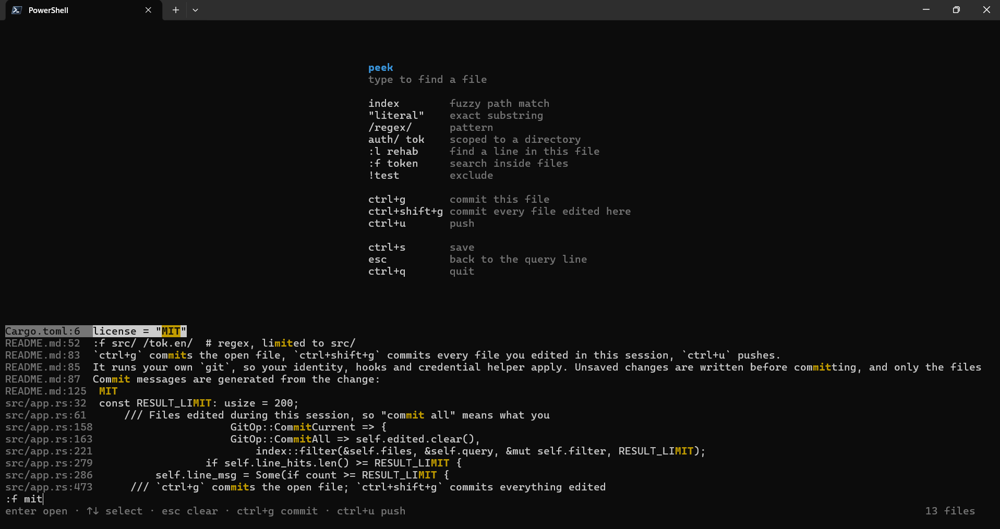
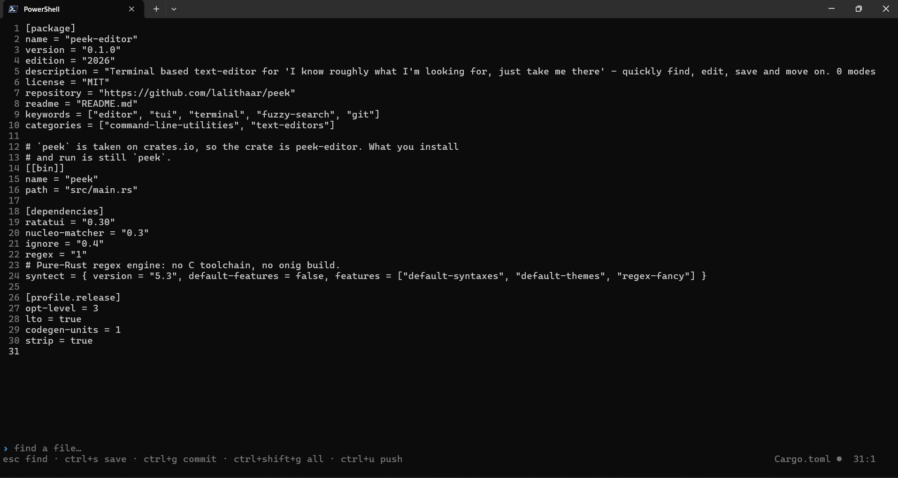

# peek

Terminal based text-editor for "I know roughly what I'm looking for, just take me there" - quickly find, edit, save and move on.

0 modes or tabs to learn.




Run it in a folder, type a few characters, press enter. No tree to click through, no tabs, nothing to configure.

## Install

```sh
cargo install peek-editor
```

From source:

```sh
git clone https://github.com/lalithaar/peek
cd peek
cargo install --path .
```

Both commands put `peek` in cargo's bin directory — `~/.cargo/bin`, or `%USERPROFILE%\.cargo\bin` on Windows — which rustup adds to your `PATH` for you. If `peek` is not found afterwards, that directory is missing from `PATH`.

Building needs a current stable Rust toolchain (1.88 or newer). `rustup update stable` if yours is older.

Works on Windows, Linux and macOS. It draws a full-screen TUI, so it has to run in a real terminal; piping input into it or its output into something else won't work.

## Usage

```sh
peek              # index the current folder
```

It respects `.gitignore`, so build output and dependencies stay out of the results.

## Finding a file

Everything you type goes into one line at the bottom. By default it matches file names.

| you type | matches |
| --- | --- |
| `index` | fuzzy file name, `src/index.rs` ranks above `docs/indexing.md` |
| `index md` | both terms |
| `"index"` | exact substring |
| `/^src\/.*\.rs$/` | regular expression |
| `src/ index` | only inside a folder |
| `!test` | everything except the matches |

Lowercase is case-insensitive. Any capital makes that term case-sensitive.

Two prefixes search file contents instead:

```sh
:f token          # every file containing "token"
:f src/ /tok.en/  # regex, limited to src/
:l rehab          # lines of the file you have open
```

`:f` results show `path:line` and open the file at that line. `:l` results move your cursor in the file you already have open.

## Keys

While picking:

| key | does |
| --- | --- |
| `up` `down` | move the selection |
| `enter` | open it |
| `esc` | clear the query, then return to the text |
| `ctrl+s` | save |
| `ctrl+q` | quit |

While editing, typing goes straight into the file:

| key | does |
| --- | --- |
| `esc`, `ctrl+o` | back to the query line |
| `ctrl+s` | save |
| `ctrl+z`, `ctrl+y` | undo, redo |
| `alt+left`, `alt+right` | previous, next file used in this session |
| `ctrl+left`, `ctrl+right` | move by word |
| `home`, `end` | start, end of line |


## git

`ctrl+g` commits the open file, `ctrl+shift+g` commits every file you edited in this session, `ctrl+u` pushes.

It runs your own `git`, so your identity, hooks and credential helper apply. Unsaved changes are written before committing, and only the files named are committed — anything else you already had staged stays where it was.

Commit messages are generated from the change:

```
peek: update src/index.rs (+12 -3)
```

```
peek: update 3 files (+40 -9)

- src/app.rs
- src/git.rs
- src/index.rs
```

Push uses the current branch's upstream, and sets one on `origin` the first time.

If your terminal sends `ctrl+shift+g` as a plain `ctrl+g`, peek accepts an uppercase `G` as the "all files" version too.

## What it doesn't do

- No tabs, splits or panes. One file at a time, with `alt+left` to walk back through the files you have used.
- No language server, completion or diagnostics.
- No plugin system and no config file. The keys above are the whole surface.
- Syntax highlighting stops at 10,000 lines; bigger files open as plain text.
- Wide characters are counted as one column, so lines of CJK text drift out of alignment.
- Recent files last for the session only.

## License

MIT, see [LICENSE](LICENSE).
